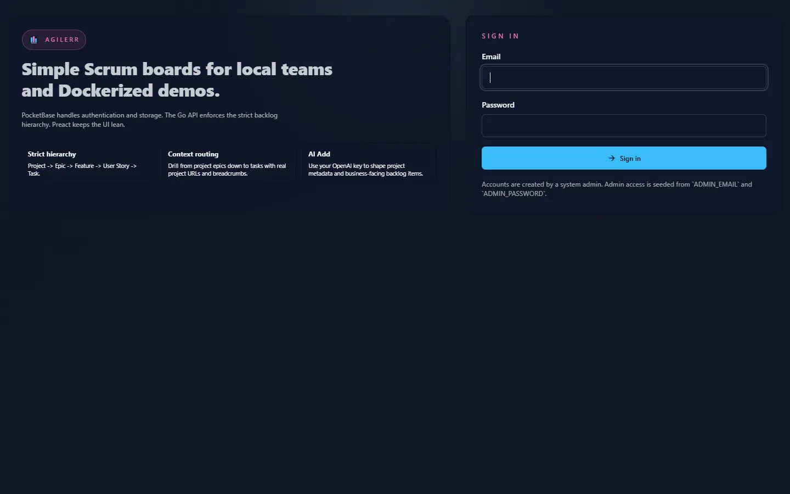

Agilerr runs as one application. You need no separate database: PocketBase is embedded, so all you need is somewhere persistent for its data directory.

## From a binary

Download the archive for your platform from [agilerr.app](https://agilerr.app), extract it and run it.

| Platform | Archive |
| --- | --- |
| Linux x64 | `agilerr-linux-amd64.tar.gz` |
| Linux ARM64 | `agilerr-linux-arm64.tar.gz` |
| macOS Apple Silicon | `agilerr-darwin-arm64.zip` |
| macOS Intel | `agilerr-darwin-amd64.zip` |
| Windows x64 | `agilerr-windows-amd64.zip` |

```bash
curl -L https://agilerr.app/downloads/agilerr-linux-amd64.tar.gz | tar xz
./agilerr
```

On startup Agilerr prints the address it is listening on. If you did not set `HTTP_ADDR` it picks a **random local port**, and if you did not set `AGILERR_API_KEY` it generates a key **for that run only** and prints it. That is ideal for trying Agilerr out. For anything you will keep, set both explicitly. See [Configuration](../configuration/).

The data lives in `PB_DATA_DIR` (default `./pb_data`, next to where you started the binary). Back that folder up.

Check the version any time:

```bash
./agilerr version
```

## With Docker Compose

```bash
curl -O https://agilerr.app/install/docker-compose.yml
docker compose up -d
```

The published compose file runs `rmalcomber/agilerr:latest`, maps port **8090**, sets the admin account and API key through environment variables, and stores data in a named volume (`agilerr_data` mounted at `/app/pb_data`).

```yaml
services:
  agilerr:
    image: rmalcomber/agilerr:latest
    container_name: agilerr
    restart: unless-stopped
    ports:
      - "8090:8090"
    environment:
      ADMIN_EMAIL: admin@agilerr.local
      ADMIN_PASSWORD: change-me-now
      HTTP_ADDR: 0.0.0.0:8090
      PB_DATA_DIR: /app/pb_data
      AGILERR_API_KEY: change-me-api-key
      OPENAI_API_KEY: ""
    volumes:
      - agilerr_data:/app/pb_data

volumes:
  agilerr_data:
```

:::caution
Change `ADMIN_PASSWORD` and `AGILERR_API_KEY` before exposing the service to anything other than your own machine.
:::

### Building the image from source

The repository also has a `docker-compose.yml` that builds from the checkout and reads a `.env` file:

```bash
cp .env.example .env
docker compose up --build
```

## Sign in

Open the address Agilerr printed (`http://localhost:8090` for Docker) and sign in with `ADMIN_EMAIL` and `ADMIN_PASSWORD`.



Next: take the [quick tour](../quick-tour/).
