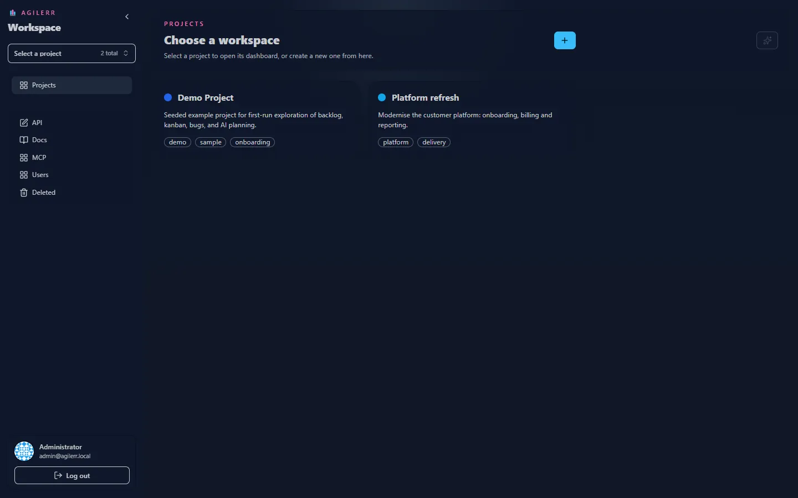
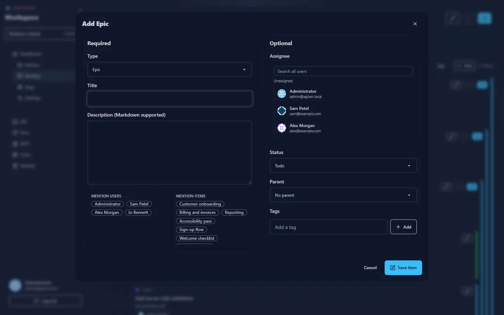
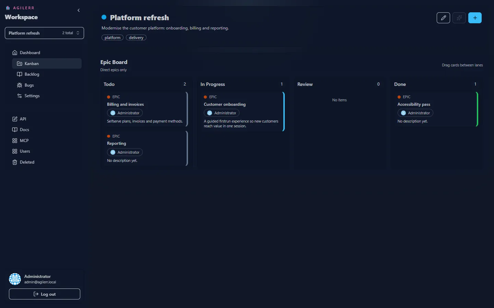

This tour assumes Agilerr is [installed](../install/) and you are signed in as the admin.

## 1. The workspace

After signing in you land in the workspace. The left sidebar is your navigation: a **project switcher** at the top, the project pages (Dashboard, Kanban, Backlog, Bugs, Settings), then the system pages (API, Docs, MCP, Users, Deleted).

A first-run install includes a **Demo Project** so there is something to look at.

## 2. Create a project

Use the project switcher to create a new project. Give it a name, a description, a colour and optional tags. Only users with the **Create Projects** permission can do this.

## 3. Add an epic

Open the **Backlog** and press the **+** button (or <kbd>Ctrl</kbd>+<kbd>A</kbd>). Choose the type **Epic**, give it a title and optionally a Markdown description, assignee, status and tags, then **Save item**.

## 4. Break it down

On the epic card, use its **+** to add a **Feature**. Add **User Stories** under features and **Tasks** under stories. The strict order is Project → Epic → Feature → User Story → Task. See [Hierarchy](../../concepts/hierarchy/).

## 5. Work it on a board

Open **Kanban**. The project board shows epics in lanes; open an epic to see its features, a feature to see its stories, a story to see its tasks. Drag cards between lanes to change their status.

## 6. Log a bug

Open **Bugs**, add a bug and give it a priority. It starts in **triage**. See [Bugs](../../guides/bugs/).

## 7. Invite people

As a system admin, open **Users**, create accounts and choose which projects each person can see and what they can do. See [Users and permissions](../../guides/users-and-permissions/).

## 8. Automate (optional)

Open **API** to copy ready-made `curl` commands that already include your API key, or **MCP** to connect an AI agent. See [REST API](../../integrations/rest-api/) and [MCP](../../integrations/mcp/).
