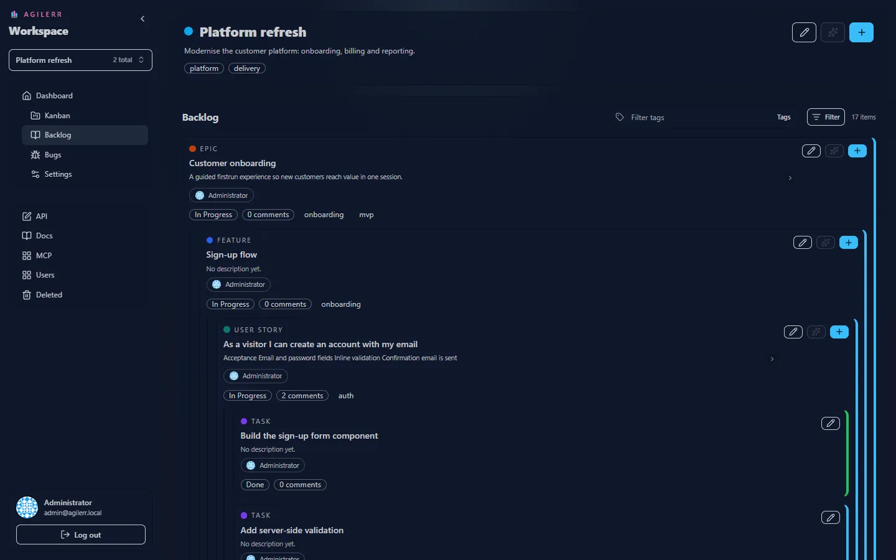

The **Backlog** shows the whole work breakdown as a nested tree: epics contain features, features contain user stories, stories contain tasks.

## Reading a card

Each card shows its **type**, **title**, a short description (collapsed by default), the **assignee**, the **status**, a **comment count** and its **tags**. The coloured bar on the right edge reflects the status. Use the chevron to expand a long description.

## Card actions

| Button | Does |
| --- | --- |
| Pencil | **Edit item** (needs Edit Units) |
| Sparkle | **AI Add** under this item (needs Add with AI and OpenAI configured) |
| Plus | **Add child** of the next level down |

## Filtering

- **Type filter**: show only epics, features, stories or tasks.
- **Tag filter**: type in the tag bar to narrow the tree to items with those tags.

When you select lower levels without their parents, Agilerr keeps the missing parents visible as **faded structural nodes**, so every item still has its context.

The header shows how many items match, for example "17 items".

## Adding work

Press **+** at the top (or <kbd>Ctrl</kbd>+<kbd>A</kbd>) to add an item in the current context, or use a card's own **+** to add a child. See [Add and edit items](../items/).
