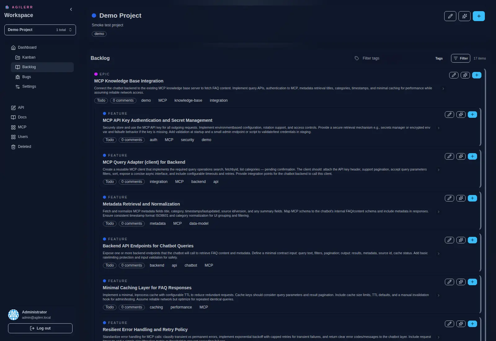
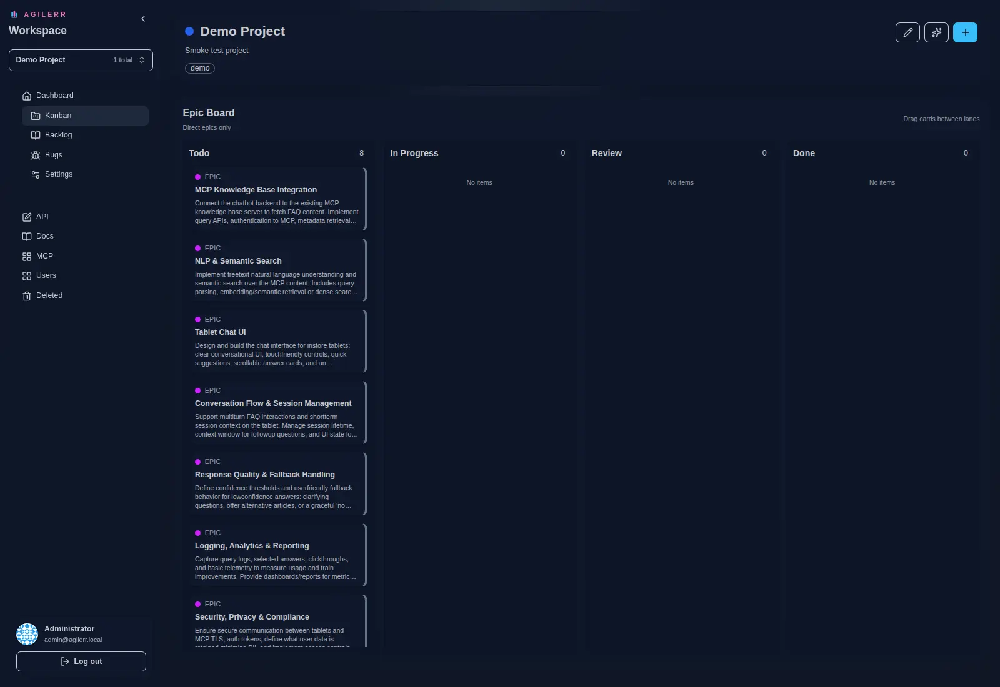

Work is organised as **Project → Epic → Feature → User Story → Task**.

## Backlog

The backlog shows the whole hierarchy. Filter by item type or by tag. Descriptions are collapsed by default so large hierarchies stay readable. Descriptions and comments support Markdown.

## Kanban

The epic board shows work moving through its states.

