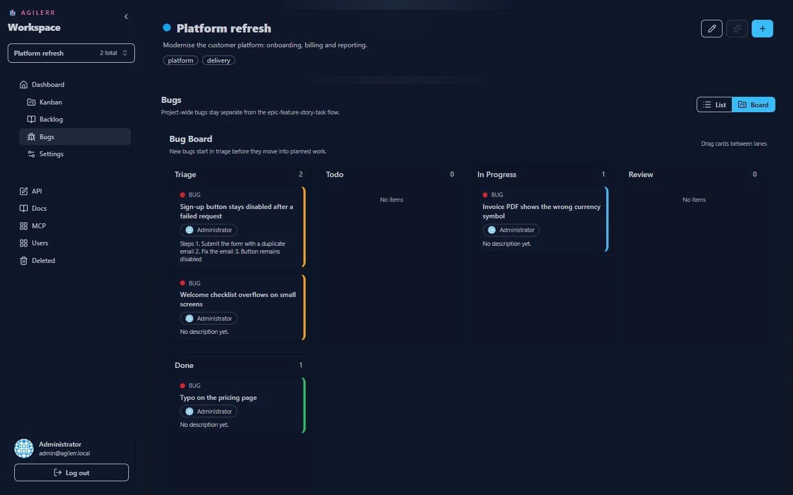

Bugs are managed **outside** the Epic → Feature → Story → Task tree, on a project-wide **Bugs** page.

## Views

The Bugs page has a **list** view and a **board** view.

## Triage first

New bugs start in **triage**. The idea is to validate the issue (reproduce it, confirm it is real, give it a priority) before it enters the main delivery flow.

## Priority

Every bug can have a priority: **critical**, **high**, **medium** or **low**. See [Statuses and priorities](../../concepts/statuses/).

## Tags and comments

Bugs have tags, Markdown descriptions and comments like any other item. A good description lists steps to reproduce.

## Permissions

You need **View Projects** and **View Units** to see bugs, and **Edit Units** to raise and change them.

Keyboard: <kbd>G</kbd> then <kbd>U</kbd> jumps to bugs.
