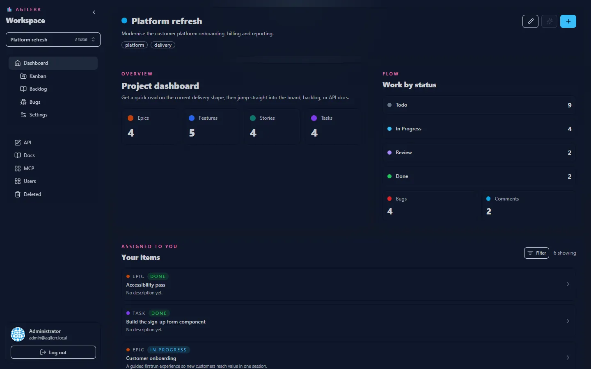

The **project dashboard** is the best place to start. It shows an overview of the project, quick links into the Kanban, Backlog and Bugs pages, and an **Assigned to you** section.

## Assigned to you

Items assigned to you are listed here with the same type filtering as the backlog, so you can focus on only the kinds of work you care about (for example just tasks).

## Quick links

The dashboard links to the main pages for the project. System admins also see links to the API docs.

## Sidebar

The sidebar is the same on every page: switch project at the top, then Dashboard, Kanban, Backlog, Bugs and Settings for that project. Below are the system pages: **API**, **Docs**, **MCP**, **Users** and **Deleted**. Collapse it with the arrow at the top to get more room.

Keyboard: <kbd>G</kbd> then <kbd>D</kbd> jumps to the dashboard. See [Keyboard shortcuts](../shortcuts/).
