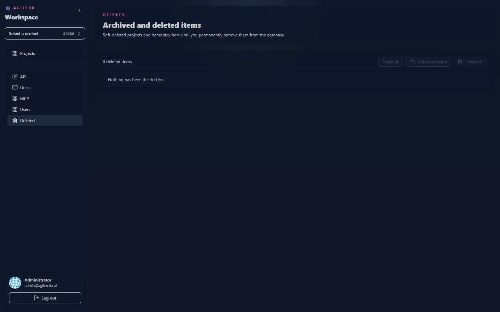

Deleting a project or item is **soft** by default. Nothing is permanently lost straight away.

## Before you delete

Agilerr shows a **preview of the full list of child titles** that will be deleted with it, so you can see the consequences. You need **Delete Units** for items and **Project Admin** for projects.

## The Deleted page

System admins can open **Deleted** in the sidebar to review soft-deleted records.

## Purging

System admins can **permanently purge** selected records from the Deleted page. You must confirm with a safety phrase first. Purging cannot be undone.

## Via the API

`DELETE /api/agilerr/units/{id}` and `DELETE /api/agilerr/projects/{id}` perform the soft delete. Matching `GET .../delete-preview` endpoints return what would be removed. `POST /api/agilerr/deleted/purge` purges. See the [REST API](../../integrations/rest-api/).
