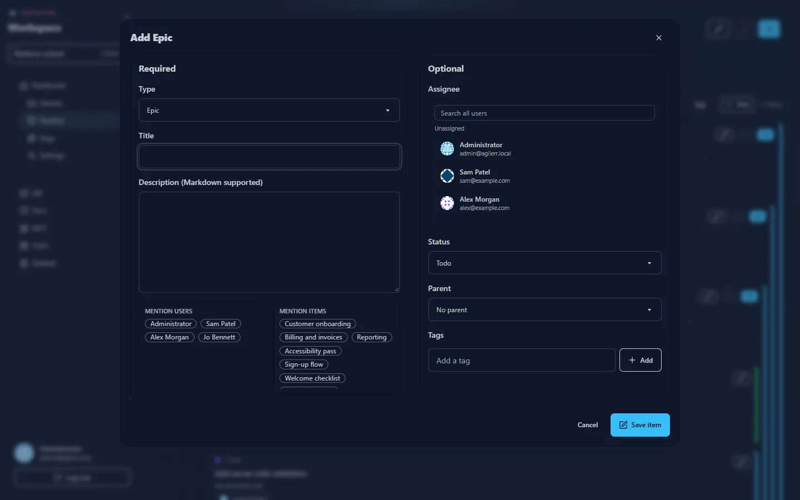
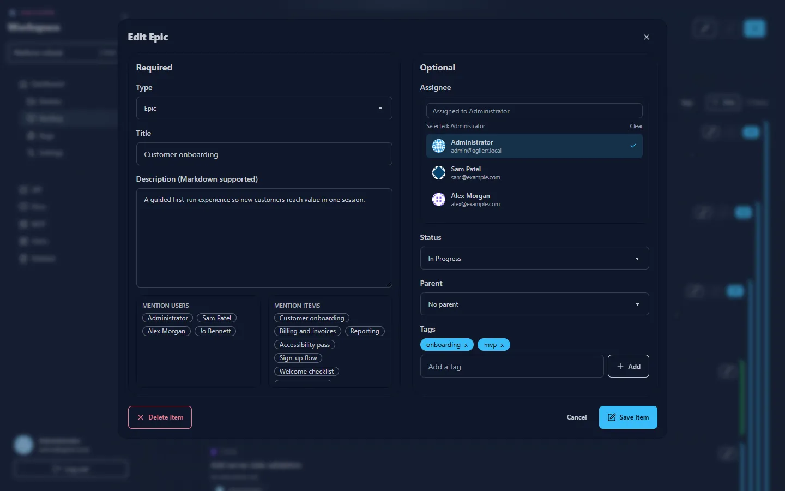

Open the form with the **+** button, a card's **+** (add a child), the pencil (edit) or <kbd>Ctrl</kbd>+<kbd>A</kbd>. Submit with **Save item** or <kbd>Ctrl</kbd>+<kbd>Enter</kbd>.

## Required

| Field | Notes |
| --- | --- |
| **Type** | Epic, Feature, User Story, Task or Bug. The choices follow the [hierarchy](../../concepts/hierarchy/). |
| **Title** | A short summary. |
| **Description** | Optional, Markdown supported. |

Under the description are shortcuts to **mention users** and **mention items**: click a name to insert a mention.

## Optional

| Field | Notes |
| --- | --- |
| **Assignee** | Search all users, or leave unassigned. |
| **Status** | Defaults to Todo. Bugs start in Triage. |
| **Parent** | The item directly above, or none for an epic. |
| **Tags** | Type a tag and press **Add**. |

## Editing

Press the pencil on any card to change the same fields.

## Moving

Change status by dragging on the [Kanban](../kanban/) board or by editing. Deleting is covered in [Deleting and recovery](../deleting/).

## Permissions

You need **Edit Units** to add or change items.
