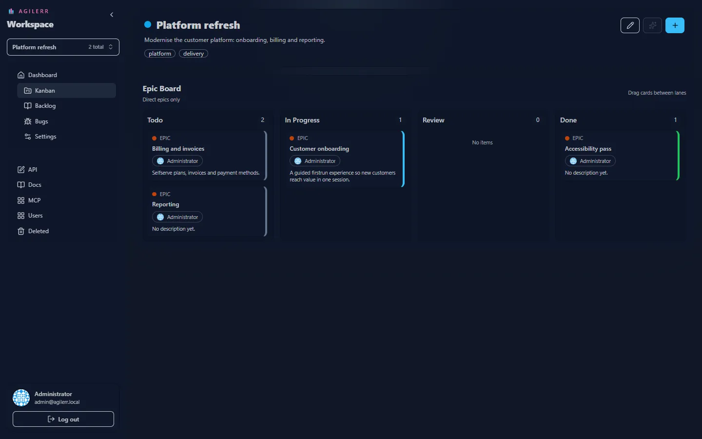

Kanban pages show only the **direct children of the current context**:

| Page | Shows |
| --- | --- |
| Project board | epics |
| An epic's board | its features |
| A feature's board | its stories |
| A story's board | its tasks |

## Lanes

**Todo**, **In Progress**, **Review** and **Done**. Each lane header shows how many cards it holds.

## Moving work

**Drag a card** from one lane to another to change its status. You need **Edit Units**. Without it you can view the board but not move cards.

## Drilling in

Open a card to see the board for the next level down, so you can work an epic's features, then a feature's stories.

Keyboard: <kbd>G</kbd> then <kbd>K</kbd> jumps to the kanban page.
