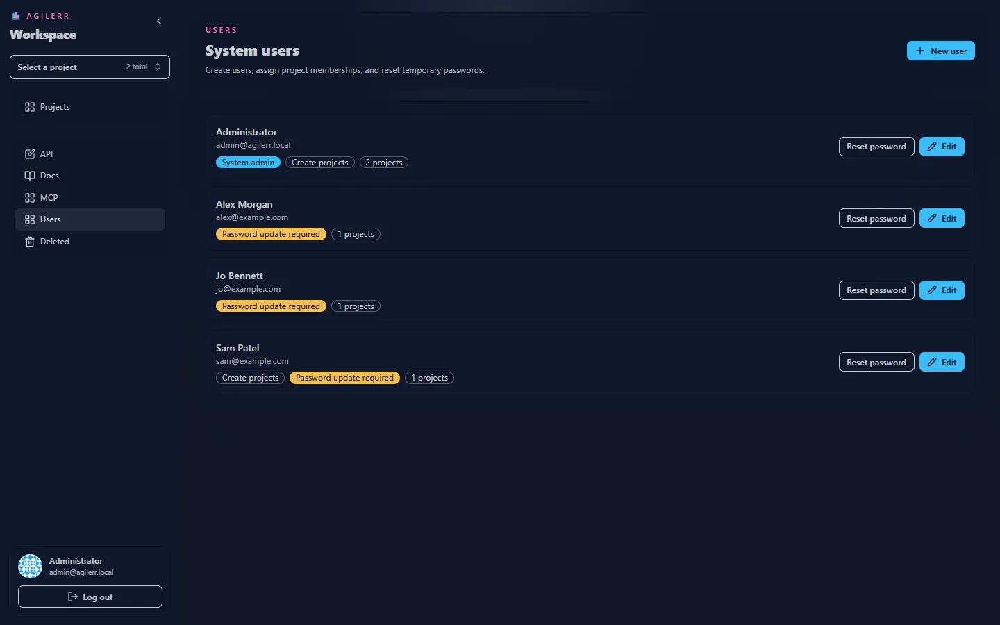
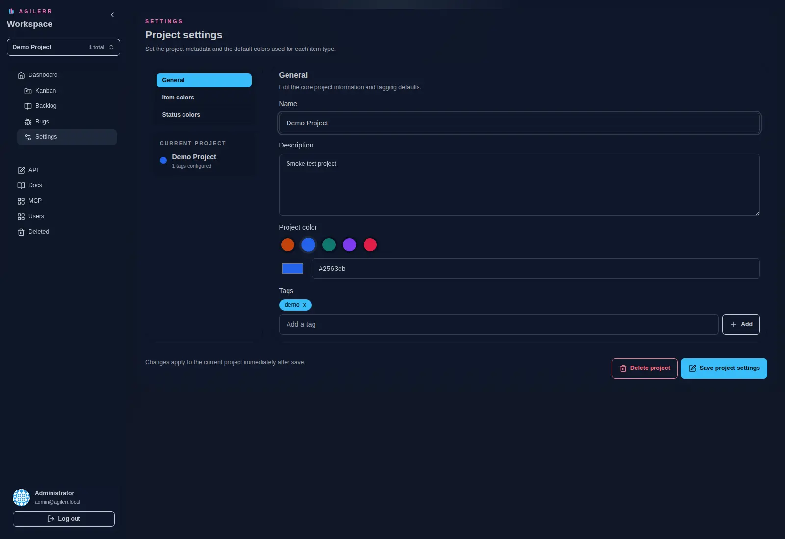

Permissions are scoped per project. System admins manage users, project membership and passwords. Actions the current user is not allowed to take are hidden in the UI.

## System users

## Project settings

