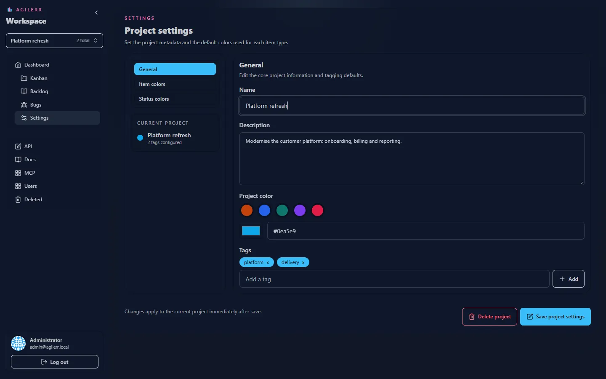

## Visibility

Projects are only visible to users who are **members** of them. System admins can see them all.

## Creating a project

Use the project switcher. A project has a **name**, **description**, **colour** and **tags**. You need the **Create Projects** permission.

## Project settings

Open **Settings** in the sidebar.

Settings are grouped. You can change the project metadata and the **colours** used for item types and statuses, which tint the cards and the board. Changing settings needs **Edit Project Settings** or **Project Admin**; editing metadata needs **Edit Projects**.

Keyboard: <kbd>G</kbd> then <kbd>S</kbd> jumps to settings.

## Deleting a project

Deleting a project is a soft delete with a preview, covered in [Deleting and recovery](../deleting/). It needs **Project Admin**.
