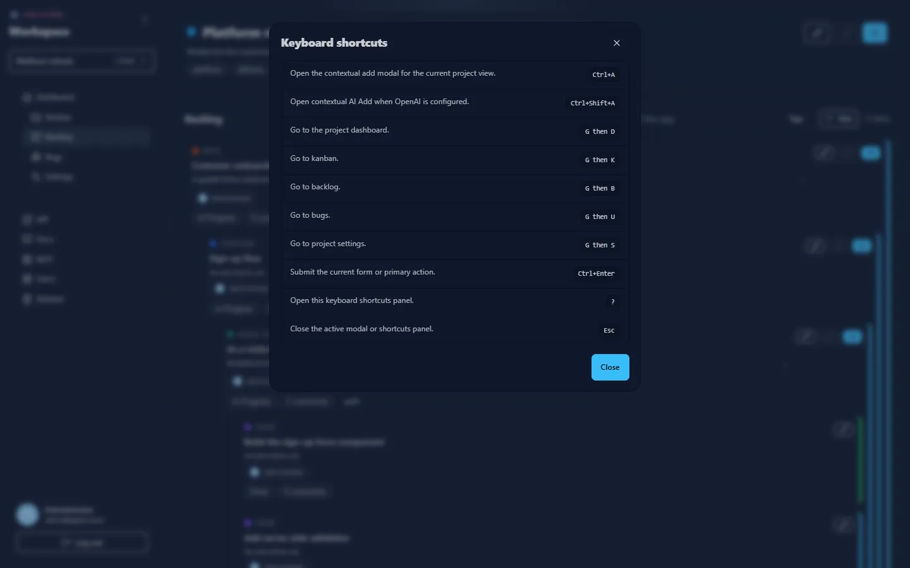

Press <kbd>?</kbd> in the app to open this list.

| Keys | Action |
| --- | --- |
| <kbd>Ctrl</kbd>+<kbd>A</kbd> (<kbd>Cmd</kbd>+<kbd>A</kbd> on macOS) | Open the contextual **add** modal for the current project view |
| <kbd>Ctrl</kbd>+<kbd>Shift</kbd>+<kbd>A</kbd> | Open contextual **AI Add** (when OpenAI is configured) |
| <kbd>G</kbd> then <kbd>D</kbd> | Go to the project dashboard |
| <kbd>G</kbd> then <kbd>K</kbd> | Go to kanban |
| <kbd>G</kbd> then <kbd>B</kbd> | Go to backlog |
| <kbd>G</kbd> then <kbd>U</kbd> | Go to bugs |
| <kbd>G</kbd> then <kbd>S</kbd> | Go to project settings |
| <kbd>Ctrl</kbd>+<kbd>Enter</kbd> | Submit the current form or primary action |
| <kbd>?</kbd> | Open the shortcuts panel |
| <kbd>Esc</kbd> | Close the active modal or panel |
