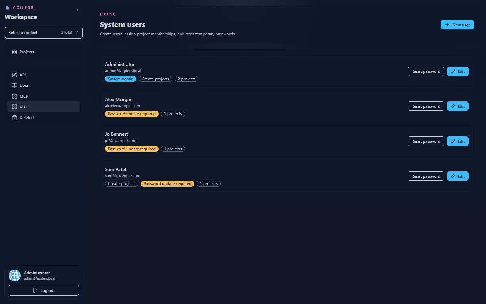

Only **system admins** manage users. Open **Users** in the sidebar.

## Creating a user

Create a user with an email and name. Choose whether they are a **System Admin** and whether they can **Create Projects**. The new account receives a **temporary password** and must change it at first sign-in before they can use the rest of the app.

## Memberships

Add the user to the projects they should see and set their permissions in each one: View Projects, View Units, Edit Units, Delete Units, Add with AI, Edit Projects, Edit Project Settings and Project Admin. See the [permissions model](../../concepts/permissions/).

A user sees only the projects they are a member of.

## Resetting a password

System admins can reset a user's password from the Users page. The user gets a temporary password and must set a new one.

## Changing your own password

Every user can change their own password. When an account is marked for first-use rotation, Agilerr blocks the app until a new password is set.

## Accounts are admin-created

There is no public sign-up. Accounts exist only because a system admin created them.
