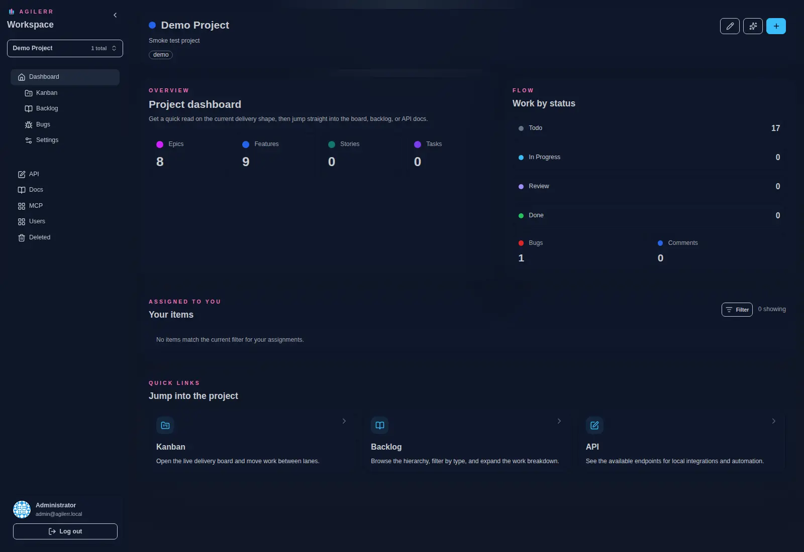

## What you get

- A strict hierarchy: **Project → Epic → Feature → User Story → Task**.
- A dedicated **bug workflow** that starts in triage.
- Dashboard, backlog, kanban board, deleted items, user admin and per-project permissions.
- Markdown descriptions and comments, tags, mentions and assignments.
- **AI Add**: an optional planning conversation that proposes items for you to review. Nothing is created until you accept it.
- A **REST API** and an **MCP** endpoint so scripts and AI agents can work with the board.
- Everything ships as a single application: the Go backend, the embedded [PocketBase](https://pocketbase.io) auth and storage, and the UI.

Support the project: [Buy Me a Coffee](https://buymeacoffee.com/rmalcomber) or [GitHub Sponsors](https://github.com/sponsors/rmalcomber).
