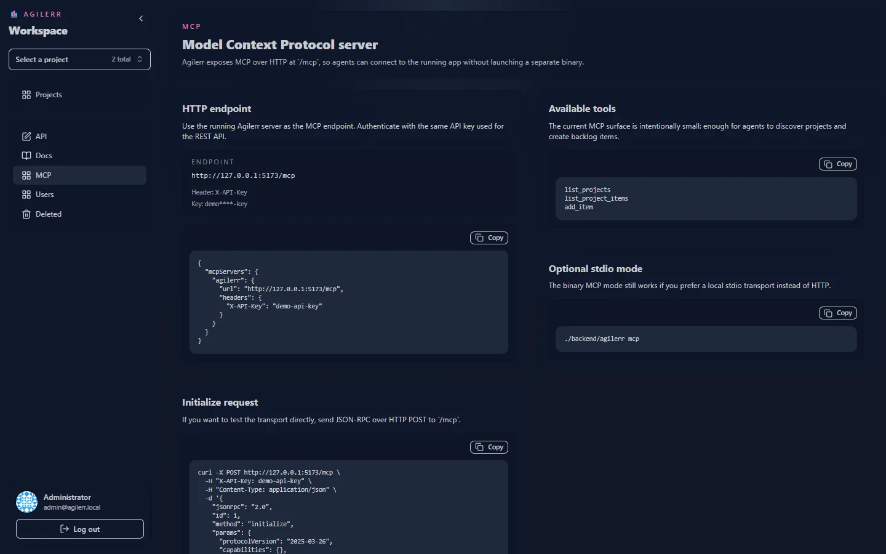

Agilerr speaks [MCP](https://modelcontextprotocol.io) so AI agents can read and create items on your board. It is available two ways: **over HTTP** from the running app, and **over stdio**.



## Over HTTP

Endpoint: **`POST /mcp`** on the same address as the app. Authenticate with `X-API-Key` (your `AGILERR_API_KEY`).

A plain `GET /mcp` returns a reminder that POST is required and which auth to send. `OPTIONS` is supported. Requests may be a single JSON-RPC message or a batch array.

```bash
curl -X POST http://localhost:8090/mcp \
  -H "X-API-Key: $AGILERR_API_KEY" -H "Content-Type: application/json" \
  -d '{"jsonrpc":"2.0","id":1,"method":"tools/list"}'
```

## Over stdio

Run the same binary with the `mcp` argument and point your MCP client at it:

```bash
./agilerr mcp
```

It reads one JSON-RPC message per line on stdin and writes responses on stdout.

## Tools

| Tool | What it does | Arguments |
| --- | --- | --- |
| `list_projects` | List all projects with ids and metadata | none |
| `list_project_items` | List items in a project so an agent can see ids before creating children | `projectId` (required) |
| `add_item` | Create an item in a project, optionally under a parent | `projectId`, `type`, `title` (required); `parentId`, `status`, `priority`, `description`, `tags`, `assigneeId` |

For `add_item`, `type` is one of `epic`, `feature`, `story`, `task`, `bug`; `status` one of `triage`, `todo`, `in_progress`, `review`, `done`; `priority` one of `critical`, `high`, `medium`, `low`.

### Example call

```bash
curl -X POST http://localhost:8090/mcp \
  -H "X-API-Key: $AGILERR_API_KEY" -H "Content-Type: application/json" \
  -d '{"jsonrpc":"2.0","id":2,"method":"tools/call","params":{"name":"add_item","arguments":{"projectId":"<project_id>","type":"epic","title":"Ship onboarding","tags":["mvp"]}}}'
```

## Tips

- Have the agent call `list_projects` then `list_project_items` first, so it uses real ids and respects the hierarchy.
- The same permissions and validation as the UI apply: an item must go under the correct parent type.
- The in-app **MCP** page (system admins) shows these examples with your real endpoint and key filled in.
