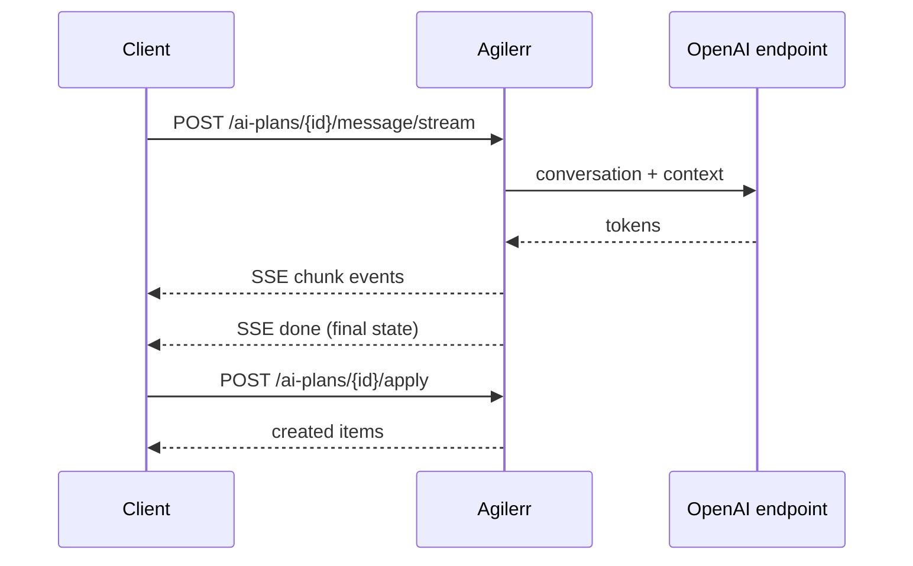

AI Add is optional and needs `OPENAI_API_KEY` configured. If the model cannot be reached the routes return **503** `{ "error": "Connecting to the OpenAI API failed." }`. See [AI Add](/guides/ai-add/) for what it does in the UI.

| Method | Path | Needs | Purpose |
| --- | --- | --- | --- |
| POST | `/ai-plans/project-draft` | system admin or *create projects* | Draft a whole project from a conversation |
| POST | `/ai-plans/project-draft/stream` | same | Same, streamed |
| POST | `/projects/{projectId}/ai-plans/open` | `addWithAI` | Open a planning session on an item |
| POST | `/ai-plans/{sessionId}/message` | `addWithAI` | Send a message to the session |
| POST | `/ai-plans/{sessionId}/message/stream` | `addWithAI` | Same, streamed |
| POST | `/ai-plans/{sessionId}/apply` | `addWithAI` | Create the accepted proposals |

## Bodies

- **project-draft**: `{ "prompt": "…", "draft": {…}, "messages": [ { "role": "user", "content": "…" } ] }` → `{ "assistantMessage", "ready", "projectDraft" }`.
- **open**: `{ "contextUnitId": "…", "targetType": "story", "includeGrandchildren": false }` → `{ "created", "state" }`.
- **message**: `{ "message": "…", "includeGrandchildren": false }` → the session state.
- **apply**: `{ "proposals": [ … ], "acceptedProposalIds": [ … ], "done": false }`.

The session state is `{ session, messages[], projectDraft, proposals[], assistantMessage, ready, hasHistory }`.

## Streaming

The `/stream` routes answer with Server-Sent Events. Draft streams emit `chunk`, `done` and `error` events; session message streams end with a `done` event carrying the final state.

