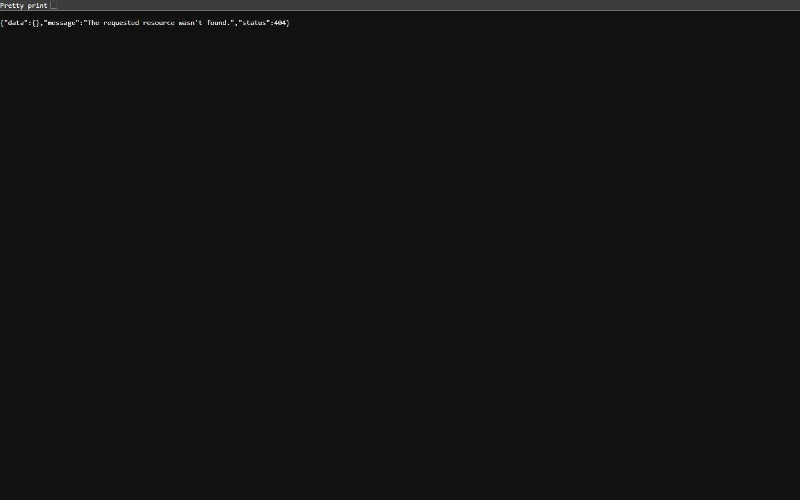

Agilerr exposes a REST API under **`/api/agilerr`**. System admins can browse it interactively on the **API** page in the app, which fills in real project and item ids and produces copy-ready `curl` commands.



:::caution[Beta]
Agilerr is in beta. Routes and response shapes may change between `0.x` releases; the [release notes](/releases/) say when they do.
:::

## Resources

Each resource has its own page. All paths are relative to `/api/agilerr`.

| Page | Routes |
| --- | --- |
| [Account](/integrations/rest-api/account/) | `/me`, `/me/password`, `/docs-config` |
| [Users](/integrations/rest-api/users/) | `/users` (system admin) |
| [Projects](/integrations/rest-api/projects/) | `/projects`, `/projects/{id}`, suggestions, delete preview |
| [Items](/integrations/rest-api/items/) | `/projects/{id}/units`, `/units/{id}`, move, delete |
| [Comments](/integrations/rest-api/comments/) | `/units/{id}/comments` |
| [AI Add](/integrations/rest-api/ai-plans/) | `/ai-plans/...`, streaming (SSE) |
| [Deleted items](/integrations/rest-api/deleted/) | `/deleted`, `/deleted/purge` (system admin) |

The [MCP](/integrations/mcp/) endpoint (`POST /mcp`) is separate and sits outside `/api/agilerr`.

## Authentication

Two ways in, checked on every request:

1. **API key**: send `X-API-Key` with the value of `AGILERR_API_KEY`. The key acts as the admin user (`ADMIN_EMAIL`), so it carries **system administrator** power. Treat it like a root password.
2. **Session token**: sign in with PocketBase's own endpoint and send the returned token as `Authorization: <token>`.

```bash
# API key
curl http://localhost:8090/api/agilerr/me -H "X-API-Key: $AGILERR_API_KEY"

# Session token (the web UI does this)
curl -X POST http://localhost:8090/api/collections/users/auth-with-password \
  -H "Content-Type: application/json" \
  -d '{"identity":"you@example.com","password":"your-password"}'
```

If `AGILERR_API_KEY` was not set, a new key is generated on every start. See [Environment variables](/reference/environment-variables/).

When an account is flagged to change its password on first use, only `/me`, `/me/password` and `/docs-config` work until it does; everything else returns 403.

## Permissions

Routes check these per-project permissions. System admins (and the API key) bypass them all.

| Permission | Allows |
| --- | --- |
| `viewProject` | see the project |
| `viewUnits` | read items, comments and suggestions |
| `editUnits` | create, edit, move items; add comments |
| `deleteUnits` | soft-delete items |
| `addWithAI` | use AI Add on the project |
| `editProjectSettings` / `editProject` | change project settings |
| `projectAdmin` | delete a project, see delete previews |

Creating projects needs the system admin role or the user's *create projects* flag. See the [permissions reference](/reference/permissions-reference/).

## Errors

Errors raised by Agilerr's own handlers return JSON with an HTTP status of 400 (invalid input), 404 (not found) or 500:

```json
{ "error": "Title is required." }
```

Authentication and permission failures (401 and 403) come back in PocketBase's standard shape instead:

```json
{ "status": 403, "message": "Edit item permission is required.", "data": {} }
```

## Quick start

```bash
# 1. find a project id
curl http://localhost:8090/api/agilerr/projects -H "X-API-Key: $AGILERR_API_KEY"

# 2. fetch its whole tree: you need these ids as parentId when creating children
curl http://localhost:8090/api/agilerr/projects/<project_id> -H "X-API-Key: $AGILERR_API_KEY"
```
