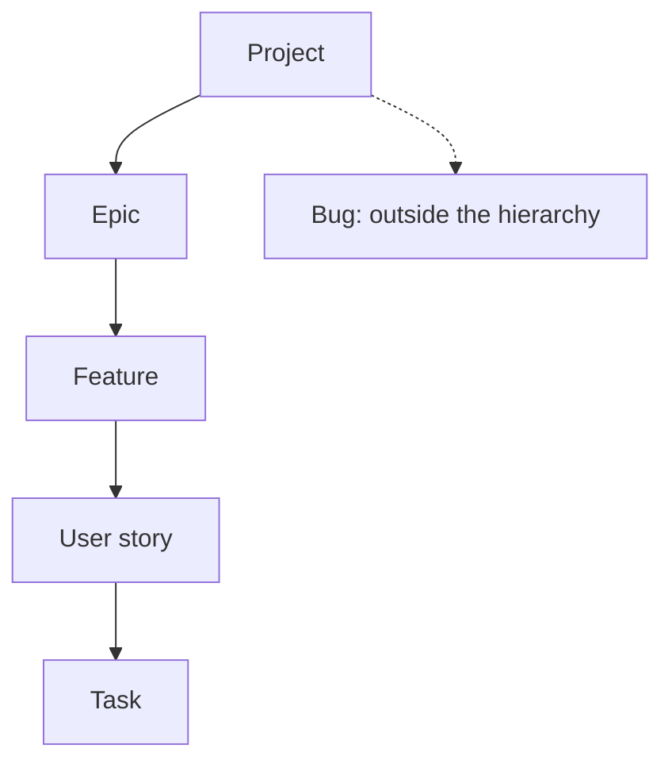

Items are called **units** in the API.

| Method | Path | Needs | Purpose |
| --- | --- | --- | --- |
| POST | `/projects/{projectId}/units` | `editUnits` | Create an item |
| PATCH | `/units/{unitId}` | `editUnits` | Update an item |
| POST | `/units/{unitId}/move` | `editUnits` | Change an item's status |
| GET | `/units/{unitId}/delete-preview` | `deleteUnits` | What deleting would remove |
| DELETE | `/units/{unitId}` | `deleteUnits` | Soft delete (returns 204) |

## Fields

| Field | Type | Notes |
| --- | --- | --- |
| `type` | string | `epic`, `feature`, `story`, `task`, `bug` (required on create) |
| `status` | string | `triage`, `todo`, `in_progress`, `review`, `done` (required on create) |
| `title` | string | required |
| `priority` | string | **bugs only**: `critical`, `high`, `medium`, `low` |
| `parentId` | string | the item directly above |
| `assigneeId` | string | a user id |
| `description` | string | Markdown |
| `color` | string | optional |
| `tags` | string array | |

Responses return `{ "unit": {…} }` with `id, projectId, parentId, assigneeId, type, status, priority, title, description, color, tags, position, createdBy, deletedAt, created, updated`.

## Rules

- The hierarchy is **epic → feature → story → task**. An item goes under the matching parent type; bugs sit outside it. See [Hierarchy](/concepts/hierarchy/).
- `triage` status and `priority` are valid for **bugs only**. See [Bugs](/guides/bugs/) and [Statuses](/concepts/statuses/).



## Examples

### Create an epic

```bash
curl -X POST http://localhost:8090/api/agilerr/projects/<project_id>/units \
  -H "X-API-Key: $AGILERR_API_KEY" -H "Content-Type: application/json" \
  -d '{"type":"epic","status":"todo","title":"Ship onboarding","description":"Create the onboarding experience","tags":["onboarding","mvp"]}'
```

### Create a story under a feature

```bash
curl -X POST http://localhost:8090/api/agilerr/projects/<project_id>/units \
  -H "X-API-Key: $AGILERR_API_KEY" -H "Content-Type: application/json" \
  -d '{"type":"story","parentId":"<feature_id>","status":"todo","title":"As a visitor I can sign up"}'
```

### Move an item

```bash
curl -X POST http://localhost:8090/api/agilerr/units/<unit_id>/move \
  -H "X-API-Key: $AGILERR_API_KEY" -H "Content-Type: application/json" \
  -d '{"status":"in_progress"}'
```
