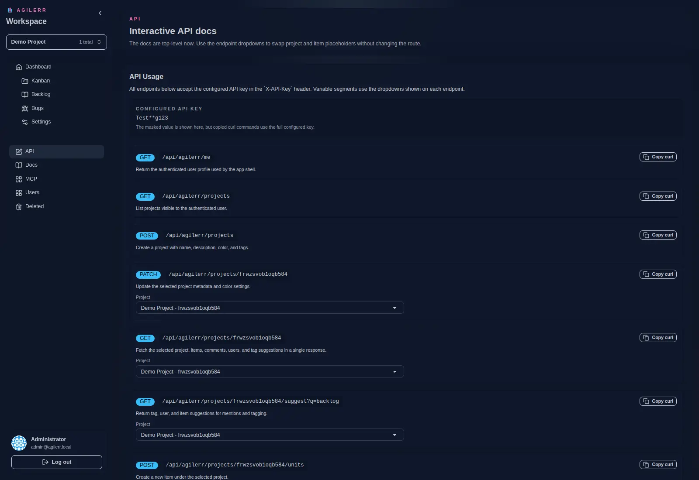
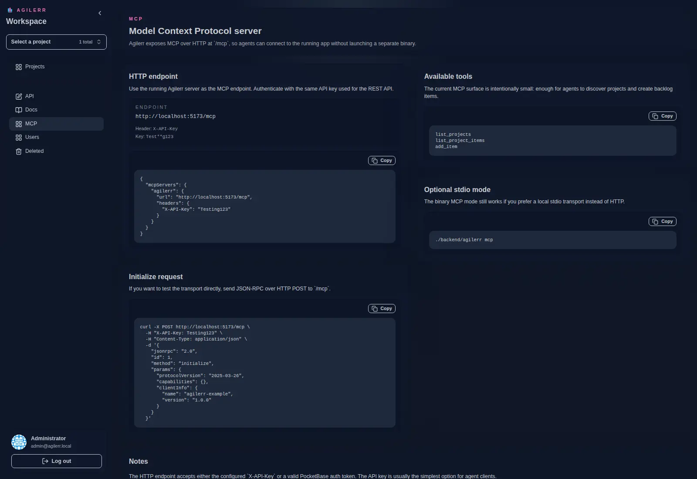

Both surfaces authenticate with `AGILERR_API_KEY`.

## REST API

Interactive API documentation is built into the app at `/api`.

## MCP

Agilerr exposes MCP over HTTP (and stdio) so MCP clients can read and manage your board. Setup details are at `/mcp` in the app.

