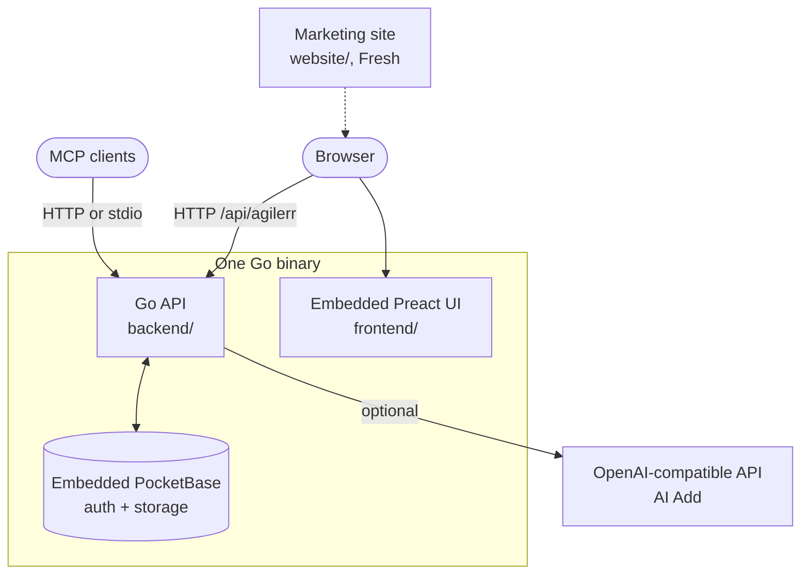
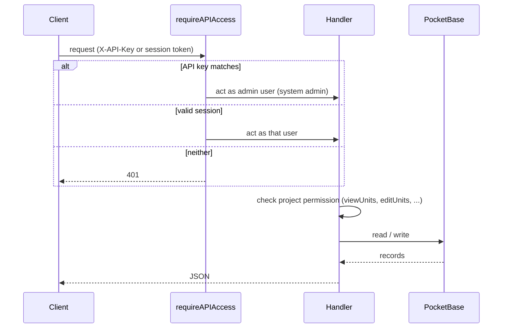

### Request and permission flow

| Folder | Contents |
| --- | --- |
| `backend/` | Go API, PocketBase bootstrap, permissions, AI flows, MCP, embedded frontend serving |
| `frontend/` | Preact product app |
| `website/` | Fresh 2 marketing site and download surface for agilerr.app |
| `scripts/` | Release scripts |
| `tools/faq-capture/` | Puppeteer tool for capturing product screenshots |

## One binary

In a release build the product frontend is **embedded in the Go binary**, so a single file serves the UI, the API and PocketBase. In development the frontend is not embedded: Vite serves it on port 5173 and proxies API calls to the backend.

## Data

PocketBase collections:

| Collection | Holds |
| --- | --- |
| `users` | accounts |
| `projects` | projects |
| `units` | epics, features, stories, tasks and bugs |
| `comments` | item comments |
| `project_memberships` | per-project permissions |
| `ai_plan_sessions`, `ai_plan_messages` | AI Add conversations |
| `app_meta` | schema and binary version state |

## Where things are in the backend

| File | Role |
| --- | --- |
| `main.go` | startup, `version` and `mcp` commands |
| `config.go` | environment variables |
| `schema.go` | collection definitions |
| `models.go` | types, validation, hierarchy rules |
| `service.go` | routes, permission checks, API handlers |
| `ai_plans.go` | AI Add sessions |
| `mcp.go` | MCP over HTTP and stdio |
| `versioning.go` | schema and binary version tracking |
