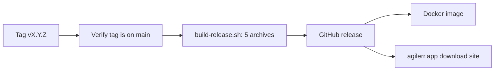

Releases are built by [GitHub Actions]({{repo}}/actions). Nothing needs to be installed locally beyond git.

## Branch flow

Feature branches go into `dev`, then `stage`, then `main`. Releases are tagged on `main`. The docs site is published from `main`.

## What a release produces

One run of the **Release** workflow (`.github/workflows/release.yml`) on a `vX.Y.Z[-suffix]` tag:

| Job | Output |
|---|---|
| `release` | Verifies the tagged commit is on `main`, builds archives with `scripts/build-release.sh`, publishes the GitHub release |
| `docker` | Builds the image and pushes `rmalcomber/agilerr:<tag>` (and `latest` for stable tags) |
| `deploy-website` | Downloads the release assets and deploys the agilerr.app download site |

| Archive | Platform |
|---|---|
| `agilerr-linux-amd64.tar.gz`, `agilerr-linux-arm64.tar.gz` | Linux |
| `agilerr-darwin-amd64.zip`, `agilerr-darwin-arm64.zip` | macOS |
| `agilerr-windows-amd64.zip` | Windows |

Tags containing a `-` (`v0.2.0-beta`) are published as **pre-releases** and do not move the Docker `latest` tag.



## Cutting a release

1. Merge to `main` through `dev` and `stage`.
2. Update `version` in `docs/src/site.config.mjs`, add a page in `docs/src/content/docs/releases/` and a row in its index (give the new page the lowest `sidebar.order`).
3. Tag and push:

   ```bash
   git tag v0.2.0-beta
   git push origin main v0.2.0-beta
   ```

4. Watch **Actions → Release**.

## The documentation site

The **Docs** workflow (`.github/workflows/docs.yml`) builds this site and deploys it to GitHub Pages whenever `docs/` changes on `main`. Enable Pages once under **Settings → Pages → Source: GitHub Actions**.
